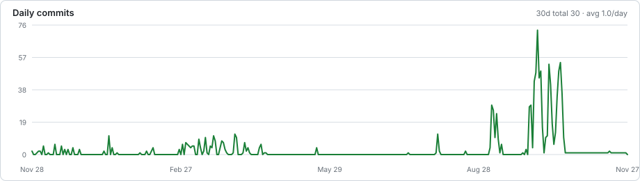

## Daily Commits

<picture>
  <source media="(prefers-color-scheme: dark)" srcset="https://raw.githubusercontent.com/MRsoymilk/MRsoymilk/main/assets/daily-contributions-dark.svg?v=261117">
  <source media="(prefers-color-scheme: light)" srcset="https://raw.githubusercontent.com/MRsoymilk/MRsoymilk/main/assets/daily-contributions-light.svg?v=261117">
  
</picture>

## Recently Active Projects

<!-- RECENT_PROJECTS:START -->
01. **[xiaomi_TM1801_light](https://github.com/MRsoymilk/xiaomi_TM1801_light)** · Rust · updated 18h ago — xiaomi TM1801 light control for Linux
02. **[Vssjx](https://github.com/MRsoymilk/Vssjx)** · Assembly · ★ 4 · updated 2w ago — 冒泡社区蜀山剑侠！学习
03. **[ctlyrics](https://github.com/MRsoymilk/ctlyrics)** · Rust · ★ 1 · updated 1mo ago — cmus terminal lyrics
04. **[LiSnap](https://github.com/MRsoymilk/LiSnap)** · Rust · updated 1mo ago — Cross-platform screenshot tool
05. **[EndlessVibe](https://github.com/MRsoymilk/EndlessVibe)** · Rust · updated 1mo ago — Just do vibe coding!
06. **[mHyprBar](https://github.com/MRsoymilk/mHyprBar)** · Rust · updated 1mo ago — A native Wayland status bar for Hyprland
07. **[ReadAll](https://github.com/MRsoymilk/ReadAll)** · Rust · updated 1mo ago — Cross-platform e-book reading
08. **[mHyprMenu](https://github.com/MRsoymilk/mHyprMenu)** · Rust · ★ 1 · updated 1mo ago — A small native Wayland cascading context menu for Hyprland.
09. **[cim](https://github.com/MRsoymilk/cim)** · C++ · updated 2mo ago — Command-im
10. **[YoAuthorize](https://github.com/MRsoymilk/YoAuthorize)** · C++ · updated 2mo ago — ya! net. simple network implement
<!-- RECENT_PROJECTS:END -->

---

The native GitHub **Contribution activity** section continues below this profile README.
